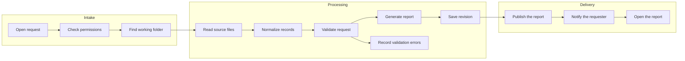

### How a request becomes a report

Follow the request from intake through delivery.

| Step | Status        | Details                                                                                                                                                                                                                                         |
| ---: | ------------- | ----------------------------------------------------------------------------------------------------------------------------------------------------------------------------------------------------------------------------------------------- |
|    1 | In review     | The report is ready for a second reader. Check the source totals against the summary and note any changes before publishing. If the numbers disagree, keep the original files with the review so the next person can reproduce the discrepancy. |
|    2 | Ready to file | `/reports/departmentpublicationreviewsummarywithsupportingrecordsandverificationnotesfromthelastcompletefinancialreportingcyclereadyforarchive.md`                                                                                              |
|    3 | Filed         | `/reports/2026/status.md`                                                                                                                                                                                                                       |

| Intake and request validation before work begins       | Permissions                                                 | Sources                                                    | Processing                                           | Review                                                     | Revisions                                                  | Publication                                                | Delivery                                                       |
| ------------------------------------------------------ | ----------------------------------------------------------- | ---------------------------------------------------------- | ---------------------------------------------------- | ---------------------------------------------------------- | ---------------------------------------------------------- | ---------------------------------------------------------- | -------------------------------------------------------------- |
| Confirm that the request contains the required inputs. | Check who can see the report and edit the underlying files. | Collect the latest files and keep a copy of the originals. | Normalize dates and amounts before comparing totals. | Ask a second reader to verify the figures and the summary. | Save the revised report separately from the earlier draft. | Publish the reviewed version in the shared reports folder. | Tell the requester where to find the report and related files. |
